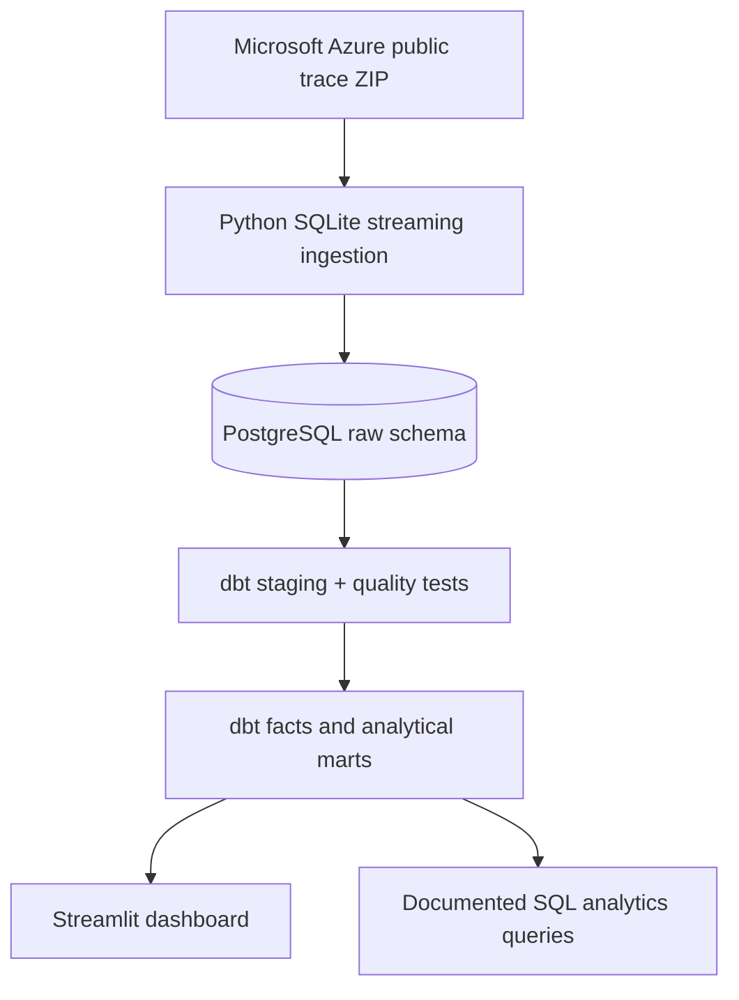

# Data Center Capacity Intelligence

**An analytics-engineering portfolio project built on real, publicly released Microsoft Azure VM allocation traces.**

> **Data provenance:** The production pipeline reads Microsoft's publicly available *Azure Trace for Packing 2020*, a sanitized 14-day trace of VM allocation requests and VM-type resource requirements. **No BuildBlock/client data are included.** The upstream trace is a cloud-computing workload trace, *not* a physical data-center power, PUE, UPS, transformer, site-level construction, or permitting dataset. No real Azure records are bundled in this repository; ingestion downloads the original source only when you run it.

Source: [Azure Public Dataset — Azure Trace for Packing 2020](https://github.com/Azure/AzurePublicDataset/blob/master/AzureTracesForPacking2020.md) (CC BY). Accompanying research: [Protean: VM Allocation Service at Scale (OSDI 2020)](https://www.microsoft.com/en-us/research/publication/protean-vm-allocation-service-at-scale/).

## Why this project exists

Data-center capacity is influenced by compute workload, hardware constraints, and reliability requirements. This project builds a repeatable analytics layer for *workload demand* and *resource profile* visibility. It deliberately avoids equating normalized VM resource units with facility MW or claiming that Azure allocations reveal real datacenter electrical headroom.

### Capabilities
- **Ingest:** Download official trace ZIP, discover actual SQLite table names using column signatures, stream records into PostgreSQL in batches, and keep source-file keys to avoid cross-file ID collisions.
- **Model:** Use **dbt Core** for staging, fact and mart models; explicit 14-day observation window; idempotent upserts.
- **Govern:** Source attribution, model contracts documented in YAML, entity uniqueness, required fields, accepted priority codes, valid time order, and referential integrity tests.
- **Visualize:** A **Streamlit** dashboard showing daily request arrivals, VMs overlapping each day, high/low priority mix, top requested VM types, and normalized resource profile distributions.
- **Validate:** Local unit tests with *clearly labeled test-only SQLite fixtures* plus GitHub Actions CI.

## Architecture



## Quick start

Requires Python 3.11+, Docker Compose, and enough space to download and process a released public trace. The release may be large; use `--max-files 1 --max-requests 20000` for an initial local run. The Azure ZIP is **not distributed here**.

```bash
# Download/unzip this repository first, or clone it after publishing to GitHub:
# git clone https://github.com/Inkyungkimm/data-center-capacity-intelligence.git
cd data-center-capacity-intelligence
python -m venv .venv
# macOS/Linux:
source .venv/bin/activate
# Windows PowerShell: .venv\Scripts\Activate.ps1
pip install -r requirements.txt
docker compose up -d
cp .env.example .env          # optional, defaults work with Docker Compose
python -m capacity_intelligence.ingest --download --max-files 1 --max-requests 20000
cd dbt_project
dbt debug
dbt build
cd ..
streamlit run dashboard/app.py
```

If you already downloaded the ZIP, use `python -m capacity_intelligence.ingest --archive /path/to/azurevmallocation_dataset2020_AzurePackingTraceV1.zip --max-files 1 --max-requests 20000`. You may also pass a raw `.sqlite`, `.sqlite3` or `.db` file to `--archive`.

To process all files and all records, use `--max-files 0 --max-requests 0`, subject to available disk/RAM and database storage. `--max-requests` limits request rows **per source SQLite file**, not globally. A partial load is for development and should **not** be presented as a representative population sample.

### Required database settings

The code reads `PGHOST`, `PGPORT`, `PGUSER`, `PGPASSWORD`, `PGDATABASE` from the environment, using `.env` if installed. Defaults match `compose.yaml`. For a production deployment, set secrets securely; never commit `.env`.

### Validate the code without downloading Azure data

```bash
pip install -r requirements-dev.txt
pytest -q
```

Tests fabricate a *tiny SQLite fixture solely to validate ingestion logic*. These are not Azure data. The full `dbt build` and UI require PostgreSQL, a real ingested dataset, and dependencies; local pytest does not prove the full production pipeline ran.

## Metrics and semantics

| Metric | Definition | Avoid misinterpretation |
|---|---|---|
| `new_vm_requests` | VM requests whose `starttime` falls within a trace day [0,14) | Not installed physical servers |
| `vms_overlapping_day` | Unique VM requests active at any point in that day (`start < day+1`, `end > day` or missing) | **Not instantaneous peak/concurrency** |
| `high_priority_share_pct` | High-priority (code 0) divided by all requests on that day | Only among observed requests |
| `completed_lifetime_days` | `endtime - starttime` for rows with non-null end | Null end times are censored, **not zero lifetime** |
| `normalized_cpu_resource` | Documented per-VM-type/per-machine fractional units | **Not physical cores, Watts, or MW** |

**Important:** Azure's IDs are anonymized; IDs are reused *across SQLite files*. A VM's identity is `(source_file, vm_id)`. The trace covers a 14-day observation window; negative start times are valid VMs already running at the start. End times may extend beyond 14 days or be `NULL` (censored). For high vs. low priority, source codes 0 and 1 are retained. See the [original documentation](https://github.com/Azure/AzurePublicDataset/blob/master/AzureTracesForPacking2020.md).

## Data models

| Model | Grain |
|---|---|
| `stg_vm_requests` | Source file + VM request ID |
| `stg_vm_type_options` | Source file + VM type option row ID |
| `fct_vm_requests` | Source file + VM request ID |
| `mart_daily_capacity_demand` | Day (0–13) + priority |
| `mart_vm_type_demand` | Source file + VM type ID |
| `mart_vm_type_resource_profiles` | Source file + VM type ID + machine ID |

## Why this is relevant to analytics engineering

This is **not** an ML prediction notebook. It demonstrates engineering fundamentals relevant to a business-facing analytics role: source ingestion, relational modeling, dbt transformation and testing, documented metric definitions, data quality, reproducibility, and a self-service dashboard.

## Data rights, attribution and limitations

- **Data**: Microsoft Azure Public Dataset, Azure Trace for Packing (2020), CC BY Attribution; cite Microsoft and the accompanying Protean paper when using this trace. Upstream data are deliberately not checked into this repository.
- **Code in this repository**: MIT (see LICENSE).
- Some upstream normalized resource fields vary by machine generation and should not be summed as a single interchangeable absolute resource pool.
- This project does not model actual data center electrical load, UPS sizing, PUE, facilities, site power, or permitting outcomes.
- Processing all files can take significant time and storage; the quick start is for a limited local sample.

## Portfolio description (only after running on real data)

> Built a Python/PostgreSQL/dbt analytics pipeline using Microsoft's open Azure VM allocation traces, with reproducible data quality tests and a self-service dashboard to explore workload demand and normalized resource profiles. Modeled source-scoped identifiers, censored VM lifetimes, and priority-aware resource demand.

Use actual processed row counts **only after** running the pipeline; do not claim results that have not been measured.

For step-by-step publishing instructions, see [docs/UPLOAD_TO_GITHUB.md](docs/UPLOAD_TO_GITHUB.md).
